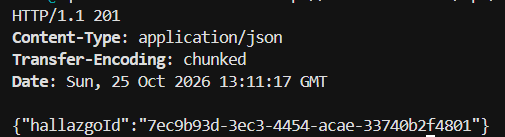
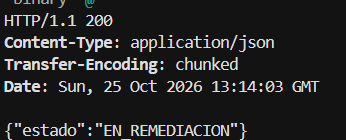
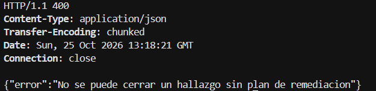
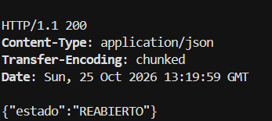
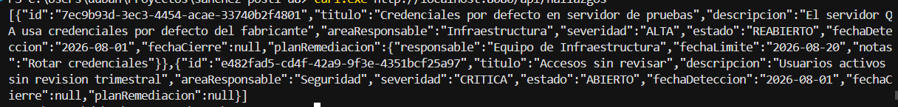
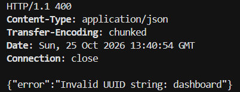
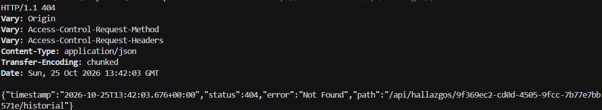

# Post-contenido — Unidad 8: Patrones Arquitectónicos II

## Descripción

Repositorio del post-contenido de la Unidad 8 de Patrones de Diseño de Software. Sistema de seguimiento de hallazgos de auditoría interna implementado con Clean Architecture (Parte 1) y extendido con un dashboard agregado y una bitácora de trazabilidad de cambios de estado (Parte 2), sobre el mismo proyecto Spring Boot (`auditoria-hallazgos`).

## Parte 1 — Clean Architecture (Hallazgos de Auditoría)

El proyecto organiza los cuatro círculos concéntricos. La dependencia del código siempre apunta hacia adentro, hacia `domain/`.

| Círculo | Paquete | Contenido |
|---|---|---|
| Entities | `domain/` | Aggregate Root `HallazgoAuditoria` y Value Objects (`HallazgoId`, `Severidad`, `EstadoHallazgo` con su máquina de estados, `PlanRemediacion`). Sin imports de frameworks. |
| Use Cases | `usecase/` | Interfaces de casos de uso, puertos (`HallazgoRepositoryPort`, `HistorialAuditoriaPort`) e implementaciones en `impl/`. Sin imports de Spring. |
| Interface Adapters | `adapter/` | `in/web` (controller, DTOs, manejo de errores) y `out/persistence` (entidades JPA y adaptadores que implementan los puertos). |
| Frameworks & Drivers | `config/` y Spring Boot + JPA + H2 | Wiring explícito de los casos de uso en `AuditoriaConfiguration`. |

```
src/main/java/com/example/auditoria/
├── domain/
│   ├── entity/HallazgoAuditoria.java
│   └── valueobject/ (HallazgoId, Severidad, EstadoHallazgo, PlanRemediacion, TransicionInvalidaException)
├── usecase/
│   ├── *UseCase.java, HallazgoNotFoundException.java
│   ├── port/ (HallazgoRepositoryPort, HistorialAuditoriaPort, vistas de lectura)
│   └── impl/ (*Service.java)
├── adapter/
│   ├── in/web/ (HallazgoController, ApiExceptionHandler, dto/)
│   └── out/persistence/ (entidades JPA, repositorios JPA, adaptadores)
├── config/AuditoriaConfiguration.java
└── AuditoriaHallazgosApplication.java
```

### Endpoints

| Método | Ruta | Descripción | Respuestas |
|---|---|---|---|
| POST | `/api/hallazgos` | Registra un hallazgo | 201 |
| PATCH | `/api/hallazgos/{id}/iniciar-remediacion` | ABIERTO/REABIERTO → EN_REMEDIACION | 200 / 400 / 404 |
| PATCH | `/api/hallazgos/{id}/cerrar` | EN_REMEDIACION → CERRADO | 200 / 400 / 404 |
| PATCH | `/api/hallazgos/{id}/reabrir` | CERRADO → REABIERTO | 200 / 400 / 404 |
| GET | `/api/hallazgos` y `/api/hallazgos/{id}` | Consulta | 200 / 404 |
| GET | `/api/hallazgos/dashboard` | Dashboard consolidado | 200 |
| GET | `/api/hallazgos/{id}/historial` | Historial cronológico | 200 / 404 |

## Parte 2 — Análisis costo-beneficio de CQRS/Event Sourcing

El comité de auditoría pide un dashboard consolidado (conteos por severidad y estado, y promedio de días de cierre por área) y Cumplimiento exige trazabilidad de cada cambio de estado. Se evaluaron los criterios de la Sección 7 de la guía antes de escribir código.

**Escala y carga.** El sistema es académico: un único desarrollador, sin usuarios concurrentes reales, y un volumen de hallazgos de decenas o cientos de registros. Lecturas y escrituras tienen la misma escala minúscula, por lo que no existe una diferencia que justifique infraestructura separada para cada lado. Separar los stacks de comando y consulta resolvería un problema de escala que este sistema no tiene.

**Complejidad de las consultas.** Los conteos por severidad y por estado son consultas JPQL con `GROUP BY` sobre la misma tabla `hallazgos`. El promedio de días de cierre necesita un filtro por estado y aritmética de fechas: la base filtra los hallazgos CERRADOS y el promedio por área se calcula sobre esas pocas filas. Nada de esto exige otra base de datos ni otro esquema de lectura: los datos ya están en la forma que las consultas necesitan.

**Consistencia.** El comité consulta el dashboard antes de la reunión mensual, como cualquier reporte bajo demanda. No se necesita tiempo real. Al usar la misma base, el dashboard refleja el estado actual sin esfuerzo y con consistencia inmediata; un modelo de lectura separado introduciría consistencia eventual, que aquí sería un costo sin ningún beneficio.

**Naturaleza de la trazabilidad.** Cumplimiento necesita ver la secuencia cronológica de cambios (de qué estado a cuál, cuándo y con qué motivo), no reconstruir el estado completo del hallazgo reproduciendo eventos. Basta una bitácora adicional que coexista con el estado actual ya persistido. Event Sourcing exigiría que la fuente de verdad fuera el log de eventos, un cambio de fondo sobre un agregado que ya funciona.

**Señales de sobreingeniería (Sección 7.2).** No hay un experto de negocio disponible para modelar eventos, el equipo es una persona sin experiencia previa en Event Sourcing, y el costo de mantener dos modelos (escritura y lectura) más un event store es desproporcionado frente a un problema que se resuelve con tres consultas y una tabla de auditoría.

**Conclusión.** CQRS y Event Sourcing completos no se justifican todavía. Se implementó una extensión liviana: tres métodos de consulta agregada añadidos al mismo `HallazgoRepositoryPort` y al mismo `HallazgoJpaRepository`, y una tabla append-only `historial_cambios_estado` escrita en la misma transacción que cada transición.

## Decisiones de diseño

### 1. `Severidad` como enum simple vs. `EstadoHallazgo` como enum con máquina de estados

`EstadoHallazgo` encapsula una regla de negocio real: qué transiciones son válidas (ABIERTO → EN_REMEDIACION → CERRADO → REABIERTO → EN_REMEDIACION), expuesta en `puedeTransicionarA(...)`. Poner la regla dentro del enum evita repetir `if` de validación en cada caso de uso y la deja probada en un solo lugar. `Severidad` es solo una clasificación: ninguna severidad tiene reglas propias ni se "transiciona" entre ellas. Darle comportamiento sería agregar código sin una regla que lo respalde. Modelar ambos con el mismo nivel de comportamiento habría dado un `Severidad` con métodos vacíos, o un `EstadoHallazgo` con la regla dispersa en los servicios.

### 2. `PlanRemediacion` como Value Object embebido vs. agregado separado

Un hallazgo no puede pasar a EN_REMEDIACION sin un plan válido ni cerrarse sin tener uno. Esa invariante debe cumplirse siempre dentro de la misma transacción, sin ventanas de inconsistencia, y ése es el criterio de límite de consistencia transaccional de los agregados (Sección 3.3 de la guía). Si el plan fuera un agregado propio con su repositorio, habría dos escrituras separadas y un momento en que el hallazgo apuntaría a un plan inexistente o inválido. Como Value Object inmutable embebido, `HallazgoAuditoria` valida el plan y cambia de estado como una sola operación.

### 3. CQRS/Event Sourcing completos vs. extensión liviana del repositorio existente

Se eligió extender el mismo `HallazgoRepositoryPort` y `HallazgoJpaRepository`. Los criterios de escala, complejidad de consultas y consistencia de la Sección 7 no apuntan a un problema que CQRS resuelva (ver análisis de arriba). El dashboard usa JPQL con `GROUP BY` sobre el mismo esquema, y el promedio de días se calcula en Java sobre las filas CERRADAS que la base ya filtró. Se evita una segunda base, un modelo de lectura y la consistencia eventual. Se reconsideraría ante múltiples consumidores de lectura con formas muy distintas o una carga real que obligue a escalar lecturas por separado.

### 4. Bitácora simple (`HistorialCambioEstado`) vs. Event Store completo

La bitácora es una tabla adicional, escrita en la misma transacción que cada transición, que coexiste con el estado actual de `HallazgoJpaEntity` sin reemplazarlo. Un Event Store completo obligaría a reconstruir el hallazgo por replay en cada lectura, sin que hoy exista la necesidad de reproducir estados intermedios ni de alimentar proyecciones desconocidas (señales de sobreingeniería de la Sección 7.2: sin experto en eventos, sin experiencia previa y con costo desproporcionado). La bitácora es append-only a nivel de código: el puerto y el adaptador solo exponen `registrar` y `listar`, y la entidad JPA no tiene setters. Limitaciones: no se registra el usuario que originó el cambio porque el laboratorio no tiene autenticación (en producción se agregaría el usuario autenticado), y la inmutabilidad se garantiza en la aplicación, no con permisos o triggers en la base.

### Decisiones técnicas adicionales

- **Rehidratación del agregado:** `HallazgoAuditoria.reconstituir(...)` carga el estado persistido sin ejecutar transiciones. Reconstruirlo "reproduciendo" `iniciarRemediacion()`, `cerrar()` y `reabrir()` falla con hallazgos REABIERTO y sobrescribe `fechaCierre`.
- **Transacción en el círculo exterior:** `AuditoriaConfiguration` envuelve los casos de uso de transición en una transacción, para que el estado y su historial se guarden juntos sin importar Spring en `usecase/`.
- **Regla de dependencia:** los casos de uso devuelven objetos de dominio o vistas propias, y el controller los convierte a DTO. Un DTO de `adapter/` nunca se importa desde `usecase/`.

## Evidencias

**Parte 1**

- Registro (201): 
- Iniciar remediación (200): 
- Cerrar sin remediación (400): 
- Cerrar y reabrir (200): 
- Listado: 

**Parte 2**

- Dashboard: 
- Historial cronológico: 
- Tabla `historial_cambios_estado` en H2: 

## Cómo ejecutar

```powershell
mvn clean package
mvn spring-boot:run
```

API: http://localhost:8080/api/hallazgos — Consola H2: http://localhost:8080/h2-console (`jdbc:h2:mem:auditoria_db`, usuario `sa`)

## Herramientas utilizadas

- Java 21, Spring Boot 3.2, Spring Data JPA, H2, JUnit 5
- Apache Maven, curl, VS Code, Git, GitHub

## Conclusiones

Esta actividad mostró que Clean Architecture no es una carpeta por círculo, sino una regla: el dominio y los casos de uso no conocen a Spring ni a JPA, y todo lo demás se conecta desde afuera. Lo más difícil fue decidir hasta dónde llegan las reglas de negocio, por ejemplo, que la máquina de estados viva en el enum y no en los servicios. El análisis de CQRS y Event Sourcing enseñó a evaluar un patrón por el problema real (escala, forma de las consultas, consistencia y trazabilidad) y no por lo sofisticado que suena; aquí bastó extender el repositorio y agregar una bitácora. Reconsideraría esa decisión si aparecieran muchos consumidores de lectura con necesidades distintas, una carga que obligue a escalar lecturas aparte, o un requisito legal de reconstruir el estado histórico completo del hallazgo.